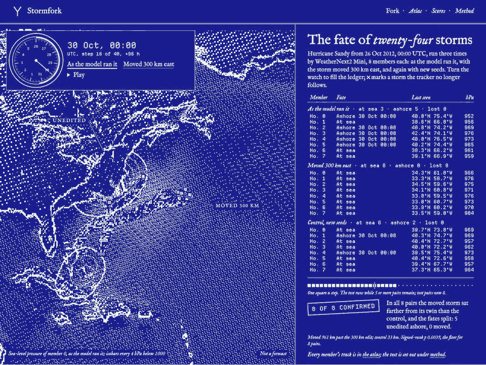

# Stormfork

Move Sandy 300 km east.

Stormfork lets you change a storm's starting state in a weather model and compare the rerun with the original. A separate control helps you check how much of the difference comes from the model's own variability.

<picture>
  <source media="(prefers-reduced-motion: reduce)" srcset="docs/hero.png">
  
</picture>

This is a model experiment, not a forecast or a reconstruction of what the real Sandy would have done. Sandy falls within the model's training period. For weather decisions, follow the [National Hurricane Center](https://www.nhc.noaa.gov/) and your local NWS office.

[Read what the comparison can tell you](docs/method.md), or try the example below.

## Try it

Python 3.12 and uv 0.13.7. No credentials are needed.

```sh
uv sync --frozen
make check
uv run stormfork --help
```

To explore the bundled sample in a browser, run `pnpm install --frozen-lockfile` in `site/`, then `pnpm dev`, and open `/#/e/demo-fixture`.

## An experiment is three runs

| Run | Starting state | Random seeds |
|---|---|---|
| baseline | unedited | seed S |
| fork | edited | the baseline's seeds |
| control | unedited | different seeds |

The fork shares the baseline's seeds, so the two differ only by the edit. The control differs only by its seeds, and shows how far the model's own variability moves a forecast. An edit is read against the control, not against zero.

The Sandy example runs a WeatherNext Cyclones Mini checkpoint, an AI weather model, from ERA5 reanalysis. Sandy is inside the model's training period, so the example shows how the model responds to an edit, not what the real storm would have done. [Method](docs/method.md) says what each comparison can and cannot support.

## What you can do

- **Run your own fork.** `stormfork run` runs baseline, fork and control. [Perturbations](docs/perturbations.md) describes the four kinds of edit and their limits, and [recipes](docs/recipes.md) shows how to write and propose an experiment.
- **Check a published one.** `stormfork verify` checks an experiment's evidence, and `stormfork rerun` reproduces it.
- **Export the evidence.** `stormfork export` writes the tracks, the divergence file and an atlas the site can show.
- **Benchmark a hindcast** against the National Hurricane Center's aids: [docs/hindcast.md](docs/hindcast.md). No hindcast score is published yet.
- **Score public forecasts.** `stormfork scores` collects WeatherNext 2 runs for coastal stations and scores them against observations: [docs/scores.md](docs/scores.md).

## Go deeper

[Architecture](docs/architecture.md), [reproducibility](docs/reproducibility.md), [publication notes](docs/publication.md) and [contributing](CONTRIBUTING.md). The code is under the [MIT licence](LICENSE); data and model terms are listed in [LICENSES.md](LICENSES.md).
