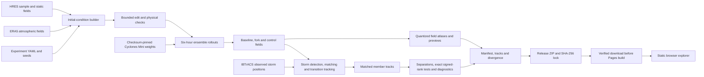
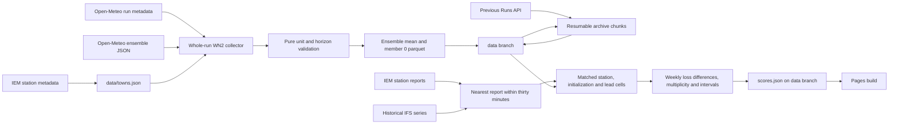

# Architecture

Stormfork has two data paths: local forecast experiments and a scheduled station
scoreboard. The browser reads their exported files; it runs no forecast model.

`stormfork ic build` prepares model inputs from the recipe's initial-condition
source. `stormfork run` applies the edit, checks physical bounds and records the
adjustment diagnostic, then runs baseline and fork with shared seeds and a
control with independent seeds. A sweep repeats the fork for its edited values.
`stormfork track` associates each member's storm with the observed starting
position, follows its later low through extratropical transition and retains
missing positions as gaps. `stormfork rerun` combines input preparation, model
execution, tracking and export.

`stormfork export` derives the evidence from matched tracks, copies the runner's
field atlases, and writes a provenance manifest and deterministic ZIP. The manifest hashes
its artifacts. The release lock pins each ZIP's SHA-256; Pages downloads and
verifies every pinned export before building. Missing home assets, unsafe
archives, checksum mismatches and invalid manifests stop deployment. The
release and its lock must be published before deployment can succeed.

The collector reads initialization metadata before and after forecast requests.
It requests the advertised initialization through 168 hours in UTC and validates
the complete six-hour grid, units and every member. It waits for the documented
ten-minute replication interval and rejects a cycle change before atomically
writing a file. Backfill restores both archived forecast and observation chunks
before selecting the next interval. Neither collection path needs model weights
or an accelerator.

Open-Meteo did not expose the advertised current WN2 run through the Ensemble
API's `run` parameter in the recorded probe. The collector uses an explicit
current-API time window instead; [ADR 0009](adr/0009-wn2-collection.md) records
that consistency limit. The historical IFS input is a lead-zero comparison;
additional leads require input forecasts carrying their actual `lead_days`.

For a town, variable and lead with WN2 coverage, all displayed model MAEs use
identical cells. A WN2 initialization must equal valid time minus the requested
lead; an older run cannot stand in for that initialization. IFS-only groups
remain available where no WN2 comparator exists. Each JSON cell publishes its
`sample_size` and physical `unit`; WN2 cells also carry the weekly comparison's
interval and badge when enough data survive. Intervals describe the mean weekly
loss difference, not an interval around an individual MAE.

`make check` runs formatting, lint, strict type checks and offline tests. The
default environment includes the model group so configuration checks load the
pinned model config. Collector and Pages workflows exclude that group. Narrow
type stubs cover the imported config loader; a signature test checks them
against the installed dependency.
