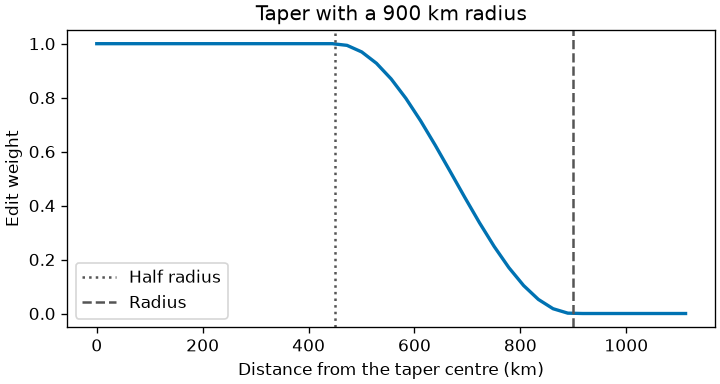
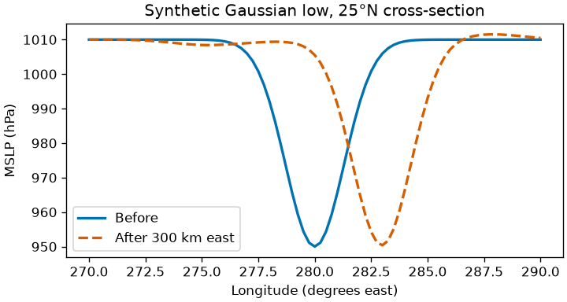

# Perturbations

`stormfork.perturb` edits floating-point xarray fields on named `lat`/`lon`
axes, with frame and pressure-level axes as documented in each function.
Temperature uses K, pressure Pa, humidity kg/kg and pressure levels hPa.
Geopotential is m²/s², not height; vertical velocity is Pa/s, not geometric
velocity. These conventions follow the
[ECMWF parameter table](https://confluence.ecmwf.int/display/CKB/ERA5%3A+data+documentation#ERA5:datadocumentation-Parameterlistings).
The cached HRES header establishes names and layout, not units.
The [method](method.md) says how an edit is compared with a control.

An explicit `names` mapping must use a supported field key and name an existing
data variable. Unknown keys raise `ValueError`; absent mapped variables raise
`KeyError`, including on identity edits. Unmapped optional fields may be absent.
SST and its land mask are required for `sst_anomaly`; an included atmospheric
`temperature` field must contain both 1000 and 925 hPa. Editable fields require
floating-point storage or raise `TypeError`, including on identity edits.

`adjustment_ratio` selects member 0, squeezes a singleton batch axis, and uses
the first two pressure states. Datetime or timedelta coordinates, when present,
must have a six-hour first interval in each input. Without time coordinates,
I must supply the initial state and its six-hour forecast in that order.

## Figures

`uv run python scripts/figures.py` draws every figure on this page into
`docs/figures/`. The first two are computed from the edit code on a made-up
field, so they show the edit and not the model.



Taper profile. The weight is 1 inside half the radius, falls along a cosine
curve and is 0 from the radius outward.



Before and after cross-section. A synthetic Gaussian low, 6000 Pa deep and
130 km wide, is moved 300 km east with a 900 km taper. The low moves about three
degrees of longitude at this latitude. Pressure away from the core differs
slightly from the original, because the smoothed background stays in place and
only the residual moves.

The other two figures read published experiments: a histogram of the adjustment
ratio from each manifest, and the fork and control separation from each
`divergence.json`. No experiment is published yet, so neither exists and I show
none. The script names each one it skips.

## Limits

SST edits and noise do not rebalance geopotential or other coupled fields, so
the first model step adjusts them. The adjustment ratio is how I watch for it:
it compares fork and baseline RMS pressure changes in the taper annulus. An
edit without a taper is measured in the same annulus around the storm's
initial position, at the radius the taper rule gives the storm there, or
400 km when no gale-force radius is recorded; a relocation is
measured around both its start and its destination and reports the larger. A
larger value flags excess change for investigation. Synthetic tests establish
the arithmetic; I have no forecast calibration, balance-residual measurement,
or validated publication threshold. A ratio near one does not prove balance.

The following are chosen experimental limits and profiles, not physical
constants or calibrated safe ranges. Their rationale is to constrain edits
while I measure model response; sensitivity to these choices remains unmeasured.

| Choice | Rationale |
|---|---|
| Taper radius: 1.5 times the largest available R34 quadrant, clamped to 400–900 km | Add a margin around reported gale-force winds; the floor gives a resolved footprint on a coarse grid and the ceiling limits changes to the surrounding circulation. The flat inner half leaves the core intact. |
| Background Gaussian width: 6 degrees, converted to grid cells | Separate storm-scale structure from a broader environment with a simple spatial filter; this is an experimental decomposition, not a balanced vortex-removal method. |
| Relocation: at most 600 km; footprints within 85 degrees latitude and the available latitude range | Keep edits local and exclude near-pole angular geometry and unsupported boundary interpolation. Constant angular shifts do not conserve spherical area integrals. |
| Intensity factor: 0.5–1.5 | Limit weakening and strengthening to moderate departures from the extracted anomaly. |
| SST change: −3 to +3 K, width at least one meridional grid spacing | Limit thermal forcing and reject unresolved Gaussian widths. Sampling does not rescale an off-node peak. |
| Ocean mask: land fraction below 0.5 | Select predominantly ocean cells and preserve predominantly land cells. |
| Air response: half the SST change at 2 m and at 1000/925 hPa only | Restrict the imposed thermal response to near-surface air while avoiding a full-column temperature shift; this is not a derived equilibrium response. |
| Noise amplitude: 0–0.05 of each slice's spatial standard deviation | Keep random disturbances small relative to the existing spatial variation; this is not an observational uncertainty estimate. |
| Validation: MSLP 87000–108500 Pa; air 170–340 K; 2 m air 180–340 K; SST 270–310 K; humidity at least zero kg/kg | Broad rejection screens for implausible edited states in these experiments, not universal atmospheric extrema. Humidity nonnegativity expresses its mass-fraction meaning; no upper humidity bound is imposed. Bounded fields must be finite so undefined states cannot pass. |
| Undefined SST: allowed only in cells with a land fraction above zero | Analyses leave sea surface temperature undefined over land, including coastal cells that are mostly sea, so the HRES sample has no SST there. Over open ocean an undefined SST is still rejected. |
| Humidity after an edit: clipped at zero kg/kg | `relocate`, `scale_intensity` and `noise` add signed anomalies, so a nearly dry cell can end slightly below zero. Clipping changes only those cells and adds back that small amount of moisture; editing in a space that cannot go negative, such as the logarithm, would change the edit everywhere else as well. |
| Relocated core: area-weighted land fraction below 0.2 | Keep the experiment predominantly oceanic and avoid an immediate land-interaction confound. |

## Track provenance

The taper fixture retains the full Katrina row at 2005-08-24 12:00 UTC from
[NOAA NCEI's North Atlantic IBTrACS v04r01 CSV](https://www.ncei.noaa.gov/data/international-best-track-archive-for-climate-stewardship-ibtracs/v04r01/access/csv/ibtracs.NA.list.v04r01.csv),
retrieved 2026-11-05. Its sidecar records source and retained-file SHA-256 hashes.
The CSV's units row is retained. NOAA's
[column documentation](https://www.ncei.noaa.gov/sites/default/files/2025-09/IBTrACS_v04r01_column_documentation.pdf)
identifies USA positions in degrees and R34 quadrants in nautical miles.
The recorded position is 24.5°N, 76.5°W and NE/SE/SW/NW radii are 60/60/0/0
nautical miles. Zero radii are retained as reported; blank, nonfinite and
negative radii are treated as missing. Positions reject the −9999 sentinel.

To reproduce, download the linked CSV to `/tmp/ibtracs.NA.list.v04r01.csv`, then:

```sh
python scripts/extract_ibtracs_taper.py /tmp/ibtracs.NA.list.v04r01.csv \
  tests/fixtures/ibtracs_katrina_taper.csv --retrieved 2026-11-05
```

The international nautical mile is exactly 1852 m under
[IHO M-3 resolution 2/1919 (as amended)](https://iho.int/iho_pubs/misc/M3-E-AUGUST18.pdf).
Spherical distances use the IUGG GRS80 mean radius R1 = (2a+b)/3, rounded to
6371.0088 km, from [Moritz, Geodetic Reference System 1980](https://geoweb.mit.edu/~tah/12.221_2005/grs80_corr.pdf). Source references accompany their use
in `stormfork/perturb/base.py`.
